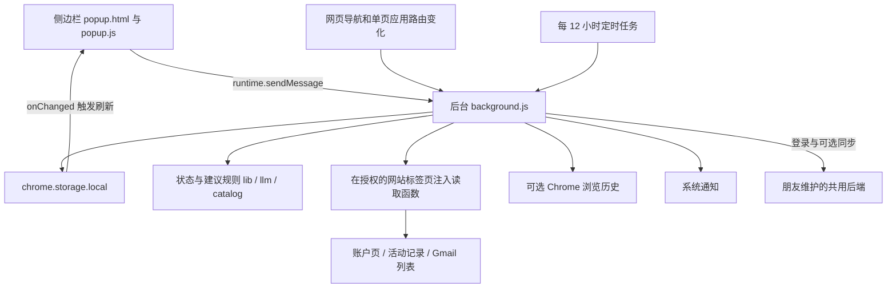

# IdleSubs 代码导览

本项目是用于发现、记录和评估闲置订阅的 Chrome 扩展，产品名为 IdleSubs。核心流程是：建立订阅清单，收集访问或服务活动信号，判断使用情况，再给出闲置、降档或续费提醒。它不会自动取消订阅或执行支付操作。

梳理基准：2026 年 10 月 18 日，代码提交 `7a859e2`，扩展版本 `2.22.2`。本文以初始梳理为基准，顶部入口与邮箱添加变更见 `docs/回归验证.md` 的 2026-10-18 记录；原有《安装说明》标题仍为 v2.11，部分说明已经过时。

你已确认：登录和同步后端由你与朋友共用，朋友维护，你目前没有后端源码。因此本仓库可独立修改插件，但涉及账号协议、服务端数据结构及部署配置时，需要与朋友协作。

## 项目结构和运行方式

这是一个原生 HTML、CSS、JavaScript 项目，使用 Chrome Manifest V3。没有 React、Vue、TypeScript、打包器或运行时 npm 依赖；仓库没有 `package.json`、锁文件和 CI 配置。业务源码都在根目录，没有分层文件夹。

扩展的两个主要入口：

- `background.js`：后台 Service Worker，负责 Chrome 事件、数据读取、存储、判断、通知、认证和同步。
- `popup.html?panel=1`：侧边栏界面。虽然文件仍叫 popup，当前工具栏图标打开的是侧边栏，manifest 没有配置 `default_popup`。

本地运行：在 Chrome 扩展管理页打开开发者模式，选择“加载已解压的扩展程序”，选中本项目目录。manifest 声明最低 Chrome 版本为 116。修改后台或 manifest 后重新加载扩展，并重新打开侧边栏。

| 文件 | 规模 | 职责和重点入口 |
| --- | ---: | --- |
| `manifest.json` | 配置 | 权限、后台入口、侧边栏入口、版本、图标 |
| `background.js` | 1624 行 | 总调度；`onVisit`、`runCheck`、`historyScan`、`catalogAdd`、`syncOnce`、消息路由 |
| `popup.html` | 816 行 | 页面结构与内嵌 CSS；我的订阅、添加入口、登录界面 |
| `popup.js` | 1243 行 | DOM 渲染、表单、排序、授权交互；`refresh`、`renderSubs`、`addFromCatalog` |
| `popup-account.js`、`popup-header.css` | 顶部界面 | 官网入口、账号菜单、反馈邮箱及复制 |
| `popup-mail.js`、`popup-mail-dialog.js`、`popup-mail.css` | 邮箱界面 | 候选渲染、直接添加、缺失商家网址补填；通过公开依赖与主界面协作 |
| `lib.js` | 147 行 | 状态计算、域名匹配、日期解析、访问次数和闲置金额 |
| `catalog.js` | 297 行 | 29 个服务的账户信息配置、页面解析、发现和建议 |
| `llm.js` | 342 行 | Claude / ChatGPT 读取、套餐归一化、对话时间统计、额度采样和建议 |
| `mailscan.js` | 517 行 | Gmail 列表抓取、账单识别、金额和日期解析、周期推断、候选聚合 |
| `history.js` | 78 行 | 浏览历史筛选、插件自身访问排除、按域名和日期汇总 |
| `auth.js` | 95 行 | 登录服务配置、请求封装、Google 授权、订阅数量限制 |
| `sync.js` | 212 行 | 上传白名单、访问时间压缩、合并、删除记录、排序同步 |
| `test_*.js` | 17 个文件 | 纯逻辑、模拟 Chrome 后台流程、模拟网页和界面测试 |
| `icons/` | 3 张图片 | 扩展与系统通知图标 |
| `安装说明.md` | 348 行 | 历史设计与操作说明，需结合现状使用 |

`background.js` 用 `importScripts` 加载各模块。除 `lib.js` 外，主要工具模块用立即执行函数包裹，并在 `globalThis` 上暴露 `MailLib`、`LlmLib`、`SubCatalog`、`HistLib`、`AuthLib`、`SyncLib`。这不是 ES Module 架构；修改加载方式或顶层变量时需要注意同一全局作用域的命名冲突。

## 组件之间如何协作

界面主要通过 `GET_STATE` 获取后台状态，而不是自行负责业务数据读写；后台通过一个 `switch (msg.type)` 分发请求。存储变化会触发界面重新获取和渲染状态。当前仍以集中式全量刷新为主；顶部账号/反馈、邮箱候选与网址补填已提取成独立界面模块，由 `popup.js` 注入公开依赖。

`withLock` 串行化主要订阅读写。检查时先读取订阅快照，在锁外执行网络和页面读取，再进入锁合并结果。`inflight` 避免重复检查同一订阅，`catalogInflight` 避免重复添加同一目录服务。

## 从发现订阅到提醒用户

### 建立订阅清单

当前导航包括“我的订阅”“邮箱发现”“历史发现”“手动添加”。“手动添加”页同时放置常见服务目录与手动网址表单。

| 入口 | 实际行为 | 数据是否证明已付费 |
| --- | --- | --- |
| 常见服务 | 请求对应网站权限，读取账户页；Claude / ChatGPT 走专用读取；有观看记录的服务另做活动检查 | 取决于账户页或接口是否成功识别；普通目录服务读失败也可以添加 |
| 历史发现 | 从本机访问流水和已授权的浏览历史中匹配目录服务，最多展示 8 个候选 | 只能证明访问过网站，不能证明购买了订阅 |
| 邮箱发现 | 手动扫描 Gmail 最近一年账单类邮件列表，聚合候选；有商家网址直接添加，缺网址原页补填，已收录服务复用目录流程 | 属于推断，包含可信度、疑似取消和过期状态 |
| 手动添加 | 保存名称、域名、月费、币种、闲置天数，使用浏览器访问模式 | 由用户确认 |

Gmail 当前运行路径只读取发件人、主题、摘要和日期，不打开正文。按商家或代收平台加显示名聚合，三天内的收据归为一次扣费，至少两个扣费事件才推断周期。只有金额与周期都能识别时才折算月费。

### 收集使用信号

**浏览器访问模式 `browser`**：监听顶层页面的 `webNavigation.onCompleted` 与 `onHistoryStateUpdated`；域名命中订阅后更新 `lastUsed` 和 `visitLog`。它衡量打开网站的行为，没有统计前台停留时长、鼠标操作或具体付费功能的使用。

**活动记录模式 `activity`**：YouTube 使用专用解析；Netflix、Prime Video、B站使用链接 ID 抓取；Claude、ChatGPT 使用网站内部接口。自定义活动页配置仍保留在后台，但当前表单没有完整配置入口。

视频活动记录主要比较最近五个条目 ID 的指纹。首次读取若能解析日期标签则建立最近使用时间，否则等待后续指纹变化。指纹变化时按检查时刻认定最近用过；重复观看同一批内容不一定使指纹变化。Netflix、Prime Video、B站的配置未启用日期标签提取，因此首次读取通常还不能提供历史使用日期。

视频类在没有读通活动记录时允许浏览器访问更新 `lastUsed`；有指纹且最近读取成功后优先依赖活动记录。Claude / ChatGPT 则只用对话更新时间，打开页面本身不会更新其使用时间。对话更新时间不是每条消息的时间，因此“活跃天数”也是代理指标。

**兼容状态 `none`**：底层仍支持“不监控”，但当前 UI 已移除该选项，安装或升级迁移会将旧数据恢复成 browser 或 activity。不能按旧说明假定用户还可以排除手机、电视上的使用。

### 补充安装前的历史

`historyScan` 在获得可选 `history` 权限后读取最近 90 天记录，只进一步查询相关域名，最多选取 400 个 URL；过滤 `isLocal === false` 的访问和插件自己打开网页的时间窗口。

历史数据用于补充各订阅的访问次数。浏览器模式若从未记录到使用且历史中也没有命中，会把 90 天前写入 `lastUsed`，并标记 `lastUsedFloor: true`。这个值表示查询窗口内未观察到访问，并非真实的最后使用日期；历史被清空、收集不完整或应用内使用都可能影响结论。

### 判断和通知

`lib.js` 的 `computeStatus` 是统一状态入口，按以下顺序判断：

| 顺序 | 条件 | 状态 |
| --- | --- | --- |
| 1 | `mode === none` | `unmonitored`，不参与判断 |
| 2 | activity 且 `signal.ok === false` | `signal_lost`，读取中断 |
| 3 | 没有 `lastUsed` | `baseline`，观察中 |
| 4 | 未使用天数达到 `idleDays`，默认 30 天 | `idle`，一段时间未用 |
| 5 | 其余有使用时间的订阅 | `active`，最近用过 |

`runCheck` 汇总读取结果、更新建议并触发通知。安装和浏览器启动后约一分钟安排首次检查，之后周期为 12 小时；也可检查全部或单个订阅。

- 闲置提醒：同一订阅通常 7 天内不重复通知。
- 信号中断：连续失败至少两次才通知；进入该状态后跳过本次续费和闲置提醒。
- 续费提醒：距续费日 0 至 3 天，存在相应退订或降档建议时通知，同一续费时间去重。
- 点击通知：打开服务网站、账单页或需重新登录的页面，不执行退订。

“读取中断保护”主要针对 activity 信号；普通 browser 订阅的账户页读取失败，并不会冻结其基于网站访问的闲置判断。通用 `computeStatus` 也不检查套餐是否付费，付费和团队账号过滤主要在具体建议函数中。

## 目录和各类读取器

需要区分两份配置：`catalog.js` 的 `PROVIDERS` 是 29 个服务的产品目录，`background.js` 的 `CATALOG` 是活动记录读取策略。增加一个能读账户页的服务，不等于为它增加了跨设备使用监测。

| 读取方式 | 主要文件 | 结果和边界 |
| --- | --- | --- |
| 账户页文字解析 | `catalog.js`、`background.js` | 用套餐正则、金额、续费关键词和空间格式识别；百度网盘另调用用量接口；营销文案与真实套餐可能混杂 |
| 视频观看历史 | `background.js` | 提取活动条目 ID；YouTube 的 `verified: true` 是源码标记，其余多项标为未实测，不代表本次实际网站验证 |
| AI 订阅 | `llm.js` | 请求最近约 100 条对话及套餐；Claude 另采集额度与续费；内部接口可能变化；只将时间、数字与诊断结构返回扩展，不保存对话正文 |
| Gmail 候选 | `mailscan.js` | 默认 5 页，可配置页数；依赖 Gmail 列表 DOM；结果需用户核对 |

AI 建议由确定性规则生成，没有调用大模型推理服务。规则包括 30 天无活动、低频使用、Claude 多周额度峰值、两家 AI 工具使用比例等。价格提示与节省金额是源码中的静态常量，不是实时市场报价。

后台读取一般在最小化的专用窗口中创建标签页，任务结束后关闭；AI 读取可复用已打开的标签页。传给 `executeScript` 的函数会被序列化到网页中执行，必须自包含，不能随意引用扩展作用域里的辅助函数。

`CHECK_CONCURRENCY = 4` 限制的是同时检查的订阅数。单个订阅的账户页和活动页可以并行读取，所以实际同时打开的读取标签页可能超过四个。

## 数据模型和同步边界

主要数据保存在 `chrome.storage.local`，不是 `chrome.storage.sync`；云端同步是应用自己的后端协议。

| 本地键 | 内容 |
| --- | --- |
| `subs` | 订阅数组，是主业务数据 |
| `records`、`paused` | 域名和时间的访问流水，最多 2000 条；paused 只暂停流水，不暂停订阅监测 |
| `history` | 历史扫描时间、域名汇总和发现候选用的 hits |
| `ownVisits` | 插件自己打开网页的域名与时间，用于排除虚假访问 |
| `mailScan`、`mailIgnored`、`mailPrefs` | 扫描进度、候选、少量主题样本、忽略项、偏好 |
| `auth` | 本地 token、用户、数量上限、最后验证时间；GET_STATE 不返回 token |
| `sync`、`subsDeleted`、`subOrder` | 同步开关与状态、删除时间记录、手动排序 |
| `pendingGrant`、`grantResult` | 授权后需要继续的动作及结果 |
| `lastCheck` | 最近一次全部检查的完成时间 |

每条订阅的关键字段：

| 字段组 | 字段 |
| --- | --- |
| 身份与配置 | `id`、`name`、`urlPattern`、`catalogId`、`mode`、`provider` |
| 费用和阈值 | `price`、`currency`、`priceSource`、`priceEstimated`、`idleDays` |
| 使用信号 | `lastUsed`、`lastUsedFloor`、`visitLog`、`hist`、`sig`、`signal` |
| 读取结论 | `account`、`llm`、`lastChecked` |
| 合并和通知 | `createdAt`、`updatedAt`、`notified`、`signalNotified`、`renewNotified` |

访问次数按与上一个保留时间点至少间隔 30 分钟去重，本地保留最近 90 天、最多 1000 条；这不是严格按连续会话结束时间划分的 session，也不是访问分钟数。

同步默认关闭。启用并登录后，订阅改动约 4 秒后触发；打开界面距上次同步超过 10 分钟也会触发。定时检查保存数据后会间接触发同步。

实际同步内容由 `SyncLib.sanitize` 和 `payload` 决定：

- 名称、域名、月费、币种、模式、最后使用时间、套餐和部分 AI 统计结论。
- 每个订阅最近 90 天、最多 300 个访问时间点，按分钟压缩为 `visits`。
- 插件自身打开页面的域名和分钟时间 `own`，最近 100 天、最多 600 条。
- 用户排序和删除记录；删除记录保留 90 天。

不上传完整访问流水 `records`、浏览历史汇总、邮件扫描候选、活动指纹 `sig`、本机 `signal`、通知去重字段及 Claude 完整采样数组。账户诊断可在本地界面展示前 600 字页面文字，不应把它笼统描述为“只有字段名”。

合并时：编辑字段以 `updatedAt` 较新者为准，真实使用日期优先且取较晚时间，账户和 AI 结果取较新的读取结果，访问时间取并集，目录服务和 AI 服务按逻辑身份去重。同步请求带 `baseVersion`，遇 409 重新合并，最多三轮；请求载荷上限 256 KiB。

## 与朋友维护的后端如何衔接

线上地址在 `auth.js` 的 `AUTH_BASE_URL`，当前为 `https://subwatch-auth.towangchuan.workers.dev`。`GOOGLE_CLIENT_ID` 也已配置。源码和旧说明称后端采用 Better Auth、Cloudflare Workers 与 D1；仓库未包含实现，本次没有核验服务端内部设计。

| 接口 | 插件侧用途 |
| --- | --- |
| `POST /api/auth/sign-up/email` | 邮箱注册 |
| `POST /api/auth/sign-in/email` | 邮箱登录 |
| `POST /api/auth/sign-in/social` | 把 Google ID token 和 nonce 交给服务端验证 |
| `GET /api/me` | 获取用户和 `subLimit`，验证登录有效性 |
| `POST /api/auth/sign-out` | 退出登录 |
| `GET /api/sync` | 拉取 `version` 和 `data` |
| `PUT /api/sync` | 提交 `{data, baseVersion}` |
| `DELETE /api/sync` | 用户选择关闭同步并删除云数据时调用 |

插件从响应头 `set-auth-token` 或响应体取得 token，后续请求使用 Bearer token。未登录最多 5 个订阅；登录后实际限制由服务端 `subLimit` 决定，null 表示不限。账号每 12 小时验证一次，网络异常保留本地登录，明确 401 才清除。

“忘记密码”目前只有提示界面，没有发送重置邮件或重置密码的实际流程。换机器加载后若 Google 登录不可用，需要与朋友核对插件 ID、Google 回调地址与服务端允许来源配置；不能只根据前端常量认为登录必然可用。

## 当前测试基线

2026 年 10 月 18 日使用 Node.js `v24.14.1` 执行现有脚本。`jsdom` 原本缺失，补充到仓库之外的临时目录，使用 `jsdom@26.1.0` 运行界面和 Gmail DOM 测试。

| 脚本 | 通过检查数 | 覆盖重点 |
| --- | ---: | --- |
| `test_lib.js` | 46 | 域名、日期、状态、读取中断、提醒、金额 |
| `test_extract.js` | 24 | 通用活动记录抓取 |
| `test_catalog.js` | 34 | 账户页解析、目录、空间、建议 |
| `test_catalog_bg.js` | 48 | 目录添加、授权续跑、历史回填、自身访问过滤 |
| `test_check_bg.js` | 14 | 检查并发、去重、部分编辑保护 |
| `test_history.js` | 16 | 历史筛选与聚合 |
| `test_llm.js` | 56 | AI 读取模拟、统计、套餐和建议 |
| `test_llm_bg.js` | 19 | AI 后台集成与失败状态 |
| `test_mailscan.js` | 99 | 邮件规则、周期、DOM 抓取、旧解析工具 |
| `test_mail_web_bg.js` | 12 | Gmail 扫描和翻页 |
| `test_mail_api_bg.js` | 4 | Gmail API 模式已移除的兼容行为 |
| `test_auth_bg.js` | 27 | 模拟账号、数量限制、Google 登录 |
| `test_sync.js` | 36 | 同步字段、合并、删除、访问和排序 |
| `test_sync_bg.js` | 15 | 模拟后端同步流程 |
| `test_popup.js` | 84 | 界面渲染、表单、授权、排序、币种与交互 |
| 合计 | 534 | 15 个脚本全部退出码为 0 |

24 个 JavaScript 文件的 `node --check` 均通过。测试以模拟 Chrome API、模拟接口和 DOM 为主，不等于 29 个真实网站都能正常读取。本次未加载真实 Chrome 扩展、未操作个人邮箱或网站账号、未运行真实后端 E2E。

运行方式为 `node test_lib.js` 等逐文件执行；涉及 DOM 的脚本需要 `NODE_PATH` 指向包含 jsdom 的 node_modules。本次目录为 `/tmp/sub-monitor-audit-deps.WdqoDy/node_modules`，临时目录可能被系统清理。`test_auth_bg.js`、`test_sync_bg.js` 在设置 `E2E` 环境变量后会访问真实服务器并执行测试动作；本次明确移除了该变量。

## 已确认的问题和后续修改的边界

### 多币种闲置金额直接相加

`popup.js` 的 `spendHtml` 已按币种分别显示总支出，但 `lib.js` 的 `wastedPerMonth` 仍把所有闲置 `price` 直接相加；`renderSubs` 再套用第一条闲置订阅的币种。

用两个闲置订阅 `$20` 与 `¥30` 验证，计算结果为 50，当前展示逻辑会标成 `$50/月`。因此“每月支出支持多币种”不能推广到“闲置金额已正确支持多币种”。

### AI 部分读取失败仍可能产生退订建议

`llmReadPage` 最终以 `!!out.plan` 判定成功，无法据此证明对话列表读取成功。模拟 ChatGPT 会话接口成功、账户和对话接口返回 500，实际得到 `ok: true`、空时间列表；随后 `llmStats` 给出 0 天，`llmAdvice` 返回“近 30 天一次都没用过，还需要 Plus 吗？”

`applyLlmResult` 会将该结果视为成功并恢复 `signal.ok`。后续修改建议明确区分“确认无对话”与“对话未读取成功”，否则会绕过原本的读取中断保护。这是本地模拟已复现的逻辑问题，不代表已经观察到真实用户误报。

### 网站访问与订阅价值之间存在口径差异

浏览器模式无法覆盖桌面软件、手机 App、电视使用；访问网站也不一定使用了付费能力。例如访问 github.com 会影响 Copilot 的使用判断，但不证明实际调用了 Copilot。网盘还可能长期提供存储价值而很少打开网页。当前 UI 又已移除“不监控”开关，因此以后调整闲置规则时需要先明确这些场景的产品口径。

### 文档和残留代码需要区别对待

旧说明中的“不监控开关”“访问记录入口”“明显的诊断入口”“默认本地后端”“访问次数不参与同步”均与现状不符。当前普通目录服务可通过 Alt 加检查进入诊断；AI 的诊断处理代码仍在，但不能据此认为 UI 已保留相同入口。

`mailscan.js` 保留旧 Gmail API 授权和正文解析工具，但后台已不再接入 API 扫描。`popup.html` 和 `popup.js` 也保留隐藏访问日志页及部分旧弹窗逻辑。后续维护时应沿实际调用链确认是否仍可达，再决定保留或清理。

### 修改时应保留的技术约束

- 新增订阅字段要同时检查保存、检查合并字段 `REFRESH_FIELDS`、同步白名单和 UI；不能只改表单。
- 检查结果合并会覆盖白名单字段，其中含价格、币种和 `lastUsed`。现有测试只证明部分编辑字段受保护，不能推断所有并发编辑都安全。
- 权限申请与用户点击、`pendingGrant`、后台恢复动作相关；删除看似冗余的续跑逻辑可能影响授权后的添加流程。
- 新增服务时需要同时考虑目录、活动策略、域名匹配与授权范围。
- 同步、定时和扫描存在内存状态与计时器，真实 Chrome Service Worker 停止及重启后的行为仍需要浏览器验证。

## 后续需求对应的修改入口

| 需求 | 主要修改位置 | 配套验证 |
| --- | --- | --- |
| 改侧边栏布局、卡片、导航 | `popup.html`、`popup.js` | `test_popup.js` 加实际侧边栏检查 |
| 改闲置天数或状态口径 | `lib.js`、`background.js` | `test_lib.js`、`test_check_bg.js` |
| 改访问次数与历史补充 | `lib.js`、`history.js`、`background.js`、`sync.js` | 历史、目录后台、同步测试 |
| 新增普通订阅服务 | `catalog.js`；必要时加 `background.js` 活动策略 | 目录解析、后台添加、真实网站读取 |
| 改 AI 判断和降档建议 | `llm.js`、`applyLlmResult`、AI 展示 | AI 纯逻辑与后台测试、真实接口检查 |
| 改 Gmail 发现效果 | `mailscan.js`、`runMailScan`、邮箱 UI | 邮件规则、DOM、后台、界面测试 |
| 修复多币种金额 | `lib.js`、`popup.js`、必要的金额解析 | 混合币种用例和 UI 检查 |
| 改同步字段或合并规则 | `sync.js`、`background.js` | 同步纯逻辑与后台测试；协议变化需朋友配合 |
| 改账号、权限或数量限制 | `auth.js`、`background.js`、`manifest.json` | 账号测试、真实授权；服务端限制需朋友配合 |

建议阅读顺序为 manifest → lib → background 的 onVisit / runCheck / 消息路由 → popup 的 refresh / renderSubs / 表单 → 本次需求对应的专用模块。这样可以先掌握主链路，再进入某个服务或某个页面的细节。
